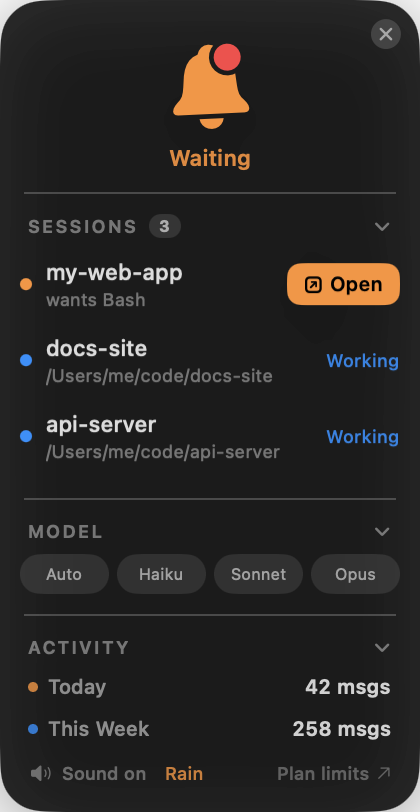
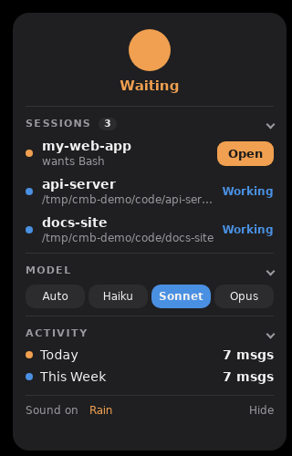

# Claude Menu Bar

A small menu bar / system tray app that shows what your **Claude Code** sessions are doing, so you can stop watching the terminal. Native on **macOS**; also runs on **Windows** and **Linux** (see [Windows and Linux](#windows-and-linux)).

- **Working, waiting or done at a glance:** the menu bar icon and a floating panel change as Claude works.
- **Every session in one list:** each running Claude Code session gets its own row with its project, git branch and what it is working on.
- **Never miss a permission prompt:** when Claude needs your approval, the session moves to the top, a soft knock plays and a notification appears. One click brings the right terminal to the front.
- **Gentle sounds:** quiet rain while Claude works, a knock when it needs you, a whistle when it finishes. All sounds are generated in the app. You can mute all of them, or just the rain.
- **Quick model switch:** set the default model (Auto, Haiku, Sonnet, Opus) for new sessions.
- **Usage counter:** how many prompts you sent today and this week.

<p align="center">
  
  &nbsp;&nbsp;
  
</p>
<p align="center"><sub>macOS (left) and Linux (right)</sub></p>

> **Unofficial.** This is a community project. It is not made by, affiliated with or endorsed by Anthropic. "Claude" and "Claude Code" are trademarks of Anthropic.

## Requirements (macOS)

- macOS 15 (Sequoia) or newer
- Xcode 16 or newer (to build from source)
- [Claude Code](https://code.claude.com) with hooks support

## Install on macOS

```bash
git clone https://github.com/aryanpappu/ClaudeMenuBar.git
cd ClaudeMenuBar
./install.sh
```

`install.sh` does three things:

1. Builds the app and installs it to `~/Applications/ClaudeMenuBar.app`.
2. Installs the small hook helper to `~/.local/bin/claude-notify`.
3. Adds six hooks to `~/.claude/settings.json`. It saves a backup first, keeps all your other settings and hooks, and never adds the same hook twice.

Want to see the hook changes before they are written? Run `./install.sh --dry-run-hooks`. Prefer to add them yourself? Run `./install.sh --no-hooks` and copy the [hook list](#hooks) below.

New Claude Code sessions start reporting straight away. Sessions that were already open pick up the hooks after a restart.

### Uninstall

```bash
./uninstall.sh
```

This removes only this app's hooks (yours are kept), the helper and the app.

## Windows and Linux

A separate tray app (Rust + Tauri) in [`crossplatform/`](crossplatform/README.md) shows the same panel. It uses the same session files and hook rules ([docs/PROTOCOL.md](docs/PROTOCOL.md)).

1. Download the installer for your system from the [latest release](https://github.com/aryanpappu/ClaudeMenuBar/releases), or from the newest successful "windows-linux" run under *Actions*:
   - Windows: `.msi` or `-setup.exe`
   - Linux: `.deb`, `.rpm` or `.AppImage`
2. Start **Claude Menu Bar**. Its icon appears in the system tray.
3. In the tray menu, choose **Set up Claude Code hooks** once. Restart open Claude Code sessions.

What's different from the Mac:
- **Open** works when the terminal's window title contains the project folder name. On Linux it needs `wmctrl`; on Wayland it copies the project path instead.
- One-Click Approve isn't available.
- On GNOME, the tray icon needs the AppIndicator extension.

Claude Code inside **WSL** with the app on Windows: run `claude-notify install-hooks --wsl` inside WSL (details in [crossplatform/README.md](crossplatform/README.md#wsl)).

## How it works

```
Claude Code hook ──► claude-notify <state> ──► ~/.claude-menubar/sessions/<id>.json ──► Claude Menu Bar
 (stdin: session JSON)    (fast, silent)          (one small file per session)          (watches the folder)
```

| Hook | State | Meaning |
|---|---|---|
| `UserPromptSubmit`, `PreToolUse` | running | Claude is working |
| `PermissionRequest`, `Notification` (permission prompt) | waiting | Claude needs your approval |
| `Stop` | done | Claude finished; shown for 30 s, then ready |
| `SessionEnd` | end | the session is removed from the list |

The helper prints nothing when run as a hook. This matters: Claude Code adds a `UserPromptSubmit` hook's printed text to the conversation.

### Hooks

If you used `--no-hooks`, add these to `~/.claude/settings.json` (replace `/Users/you` with your home folder):

```json
{
  "hooks": {
    "UserPromptSubmit":  [{ "matcher": "", "hooks": [{ "type": "command", "command": "\"/Users/you/.local/bin/claude-notify\" running" }] }],
    "PreToolUse":        [{ "matcher": "", "hooks": [{ "type": "command", "command": "\"/Users/you/.local/bin/claude-notify\" running" }] }],
    "PermissionRequest": [{ "matcher": "", "hooks": [{ "type": "command", "command": "\"/Users/you/.local/bin/claude-notify\" waiting" }] }],
    "Notification":      [{ "matcher": "", "hooks": [{ "type": "command", "command": "\"/Users/you/.local/bin/claude-notify\" waiting" }] }],
    "Stop":              [{ "matcher": "", "hooks": [{ "type": "command", "command": "\"/Users/you/.local/bin/claude-notify\" done" }] }],
    "SessionEnd":        [{ "matcher": "", "hooks": [{ "type": "command", "command": "\"/Users/you/.local/bin/claude-notify\" end" }] }]
  }
}
```

## Privacy: what the app reads and writes

Everything stays on your Mac. The app makes no network requests. It only opens two links in your browser when you click them: "Plan limits" and "About / GitHub".

| File | Access | Why |
|---|---|---|
| `~/.claude-menubar/sessions/*.json` (Windows: `%LOCALAPPDATA%\ClaudeMenuBar\sessions`) | written by the helper, read by the app | One small file per session: state, project folder, requested tool. No prompt text. Deleted when the session ends; leftovers are removed after 24 hours. |
| `~/.claude/history.jsonl` | read | Counts today's and this week's prompts. Only this week's timestamps are kept in memory, never the prompt text. After the first read, only new lines are read. |
| `~/.claude/projects/**/*.jsonl` (session transcripts) | read, last 64 KB | Shows the git branch and the session title in the session row. Paths outside this folder are refused. |
| `~/.claude/settings.json` | read; write when you pick a model | Changes only the `model` key. The file is re-read just before writing and replaced atomically. If it isn't valid JSON, the app doesn't touch it. |

"Approval needed" banners show only the project name and the requested tool. "Done" banners say "Task finished". Turn on **Show Prompt in Banners** if you want the session title in "Done" banners instead.

## Permissions

- **Notifications:** for "Approval needed" and "Done" banners. Optional.
- **Accessibility:** needed to bring a session's terminal window to the front, and for One-Click Approve.

### One-Click Approve (off by default)

When it's on, the **Approve** button brings the session's terminal to the front and types `y` + Return into it. Safety checks:

- It acts only when exactly one terminal or editor window matches the project name, as a whole word. If any terminal can't be checked, it does nothing.
- Just before typing, it checks that this exact window is focused and that the same request is still waiting.
- Questions that need a typed answer never get an Approve button; you get **Open** instead.
- It works only in known terminals and editors (Terminal, iTerm2, Ghostty, WezTerm, Alacritty, Warp, Hyper, VS Code, Cursor, Xcode, JetBrains IDEs).

Even so, if two sessions share a folder name, the button can't tell them apart. That is why it's opt-in. When it's off, the button reads **Open** and only brings the terminal forward, so you answer the prompt yourself.

## Build from source (developers)

```bash
brew install xcodegen
xcodegen generate              # creates ClaudeMenuBar.xcodeproj from project.yml
open ClaudeMenuBar.xcodeproj   # or: ./rebuild.sh  (build + reinstall, hooks untouched)
```

Builds are ad-hoc signed by default, so no Apple account is needed. Ad-hoc signatures change on every build, so macOS asks for Accessibility permission again after each rebuild. To avoid that, create `Config/Signing.local.xcconfig` (git-ignored) with your own identity:

```
CODE_SIGN_IDENTITY = Developer ID Application
DEVELOPMENT_TEAM = ABCDE12345
```

You can test the app without Claude Code:

```bash
echo '{"session_id":"demo","cwd":"/tmp/my-app","hook_event_name":"PermissionRequest","tool_name":"Bash"}' \
  | ~/.local/bin/claude-notify waiting
echo '{"session_id":"demo"}' | ~/.local/bin/claude-notify end
```

See [CLAUDE.md](CLAUDE.md) for the architecture, [docs/REVIEW.md](docs/REVIEW.md) for known issues and the roadmap, and [docs/CROSS_PLATFORM.md](docs/CROSS_PLATFORM.md) for the plan to support Windows and Linux.

## Troubleshooting

| Problem | Fix |
|---|---|
| Icon never changes | Check the hooks exist in `~/.claude/settings.json`, and restart the Claude Code session. |
| "Grant" button | Allow Claude Menu Bar in System Settings → Privacy & Security → Accessibility. |
| Asked for Accessibility after every rebuild | Use a stable signing identity (see above). |
| Open button doesn't find the window | The terminal window title must contain the project folder name. Most terminals show it by default. |
| No banners | Allow notifications for Claude Menu Bar in System Settings → Notifications. |

## Contributing

Issues and pull requests are welcome. Please keep the hook helper fast and silent, and never send prompt text anywhere.

## License

[MIT](LICENSE) © 2026 aryanpappu
